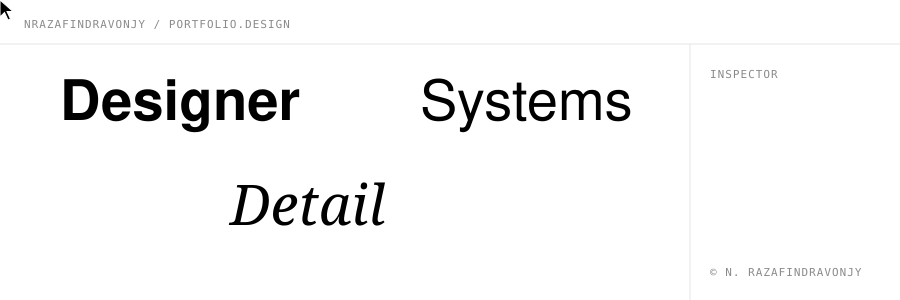

<picture>
  <source media="(prefers-color-scheme: dark)" srcset="assets/header-dark.svg">
  
</picture>

# Patrick Razafindravonjy

**Nirintsoa Patrick Razafindravonjy** — product & visual designer.

```
I design interfaces, identities and the systems behind them.
Less, but better.
```

### Selected work

| № | Project | Focus |
|---|---------|-------|
| 01 | [**Trakeo**](https://github.com/nrazafindravonjy-cmd/trakeo) | Personal finance for students that simulates the rest of your month and shows what you can safely spend today. |
| 02 | [**Eripoo**](https://github.com/nrazafindravonjy-cmd/eripoo) | Offline-first Flutter app that guides entrepreneurs in Madagascar, in Malagasy, French and English. |
| 03 | [**Tafita**](https://github.com/nrazafindravonjy-cmd/tafita) | Expo app to discover Madagascar's places, hidden gems and culture, and share travellers' finds. |

---

<sub>Currently open to collaborations — reach out via [email](mailto:n.razafindravonjy@gmail.com).</sub>
